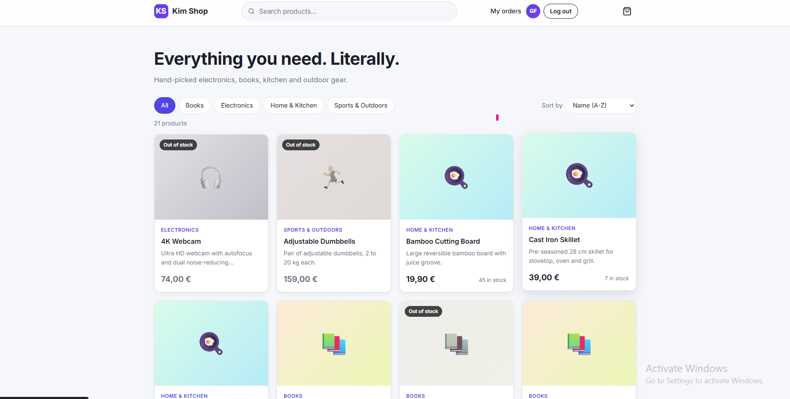
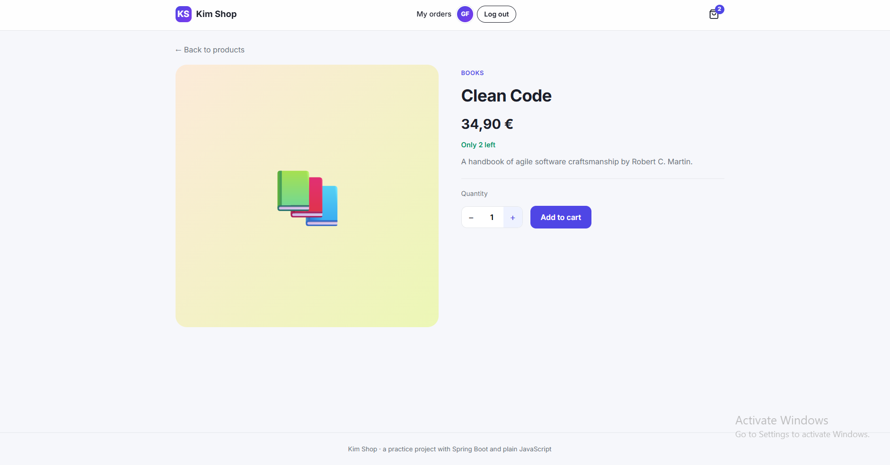
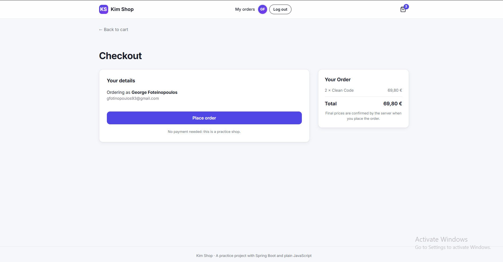
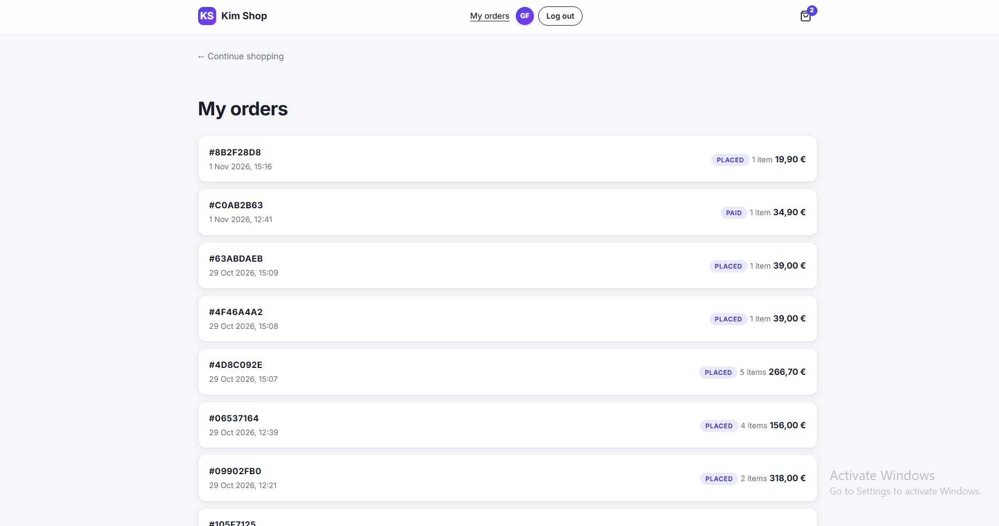
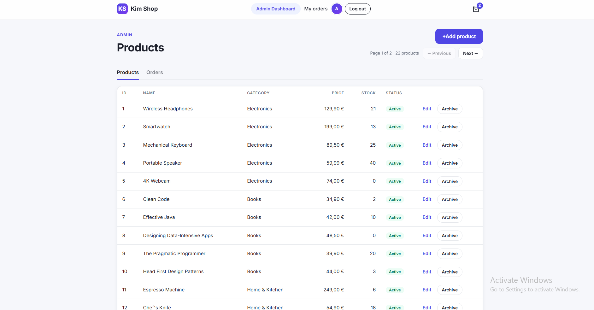
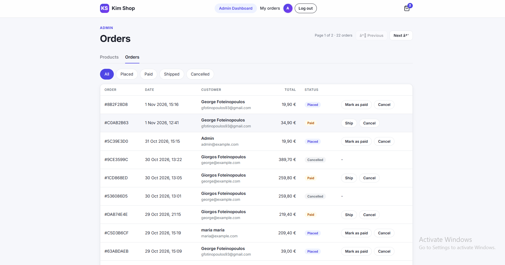
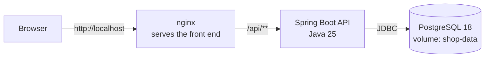

# Kim Shop 

A full-stack online shop built as a learning project: a **Spring Boot REST API** with **PostgreSQL**,
a **plain HTML/CSS/JavaScript** front end (no framework), **JWT** authentication with customer and
admin roles, and the whole application running with **one `docker compose up`**.


---

## Screenshots

| Shop | Product |
|---|---|
|  |  |

| Checkout | My orders |
|---|---|
|  |  |

| Admin: products | Admin: orders |
|---|---|
|  |  |

---

## Features

**Customers**
- Browse the catalog: category filter, search, sorting, pagination
- Product pages with stock information and optional product photos
- Cart stored in the browser (survives reloads, synced across tabs)
- Register, log in, and stay logged in across pages (JWT)
- Checkout with server-side prices and stock checks
- Order confirmation and an order history ("My orders")

**Admins**
- "Admin Dashboard" visible only to admins
- Products: create, edit, archive (soft delete) and restore
- Orders: list all orders, filter by status, and move them through their life cycle
  (`PLACED → PAID → SHIPPED`, or `CANCELLED` with automatic restocking)

**Under the hood**
- Stateless security with signed JWTs, role-based access (`CUSTOMER`, `ADMIN`)
- Consistent error responses (RFC 9457 `ProblemDetail`) for 400 / 401 / 403 / 404 / 409
- Database schema versioned with Flyway, validated by Hibernate at startup
- Smooth page navigation (View Transitions, prefetch on hover), accessible markup

---

## Tech stack

| Layer | Technology |
|---|---|
| Back end | Java 25, Spring Boot 4.1 (Web MVC, Data JPA, Validation, Security, Actuator) |
| Security | Spring Security, JWT (HS256) via `spring-security-oauth2-jose`, BCrypt |
| Database | PostgreSQL 18, Flyway migrations, Hibernate 7 |
| Front end | Plain HTML, CSS and JavaScript (ES modules), no framework, no build step |
| Infrastructure | Docker (multi-stage build), nginx (static files + reverse proxy), Docker Compose |

---

## Architecture



- **nginx** is the only service exposed to the outside (port 80). It serves the static front end
  and forwards every `/api/…` request to the backend, so pages and API share one origin (no CORS).
- **The backend** is a layered Spring Boot application, organised **by feature**
  (`catalog`, `orders`, `auth`, `users`, `security`, `common`): controller → service → repository,
  with business rules inside the entities (rich domain model).
- **PostgreSQL** stores its data in a Docker volume; the schema is created and versioned by Flyway.

---

## Run it with Docker (recommended)

**Requirements:** [Docker Desktop](https://www.docker.com/products/docker-desktop/). Nothing else (no Java, no Node).

1. **Clone the repository**
   ```bash
   git clone https://github.com/GiorgosFoteinopoulos/online-shop.git
   cd online-shop
   ```

2. **Create your `.env` file** from the template
   ```bash
   cp .env.example .env        # Windows cmd: copy .env.example .env
   ```
   and fill in the values. Generate a JWT secret (32 random bytes, Base64) with:
   ```bash
   docker run --rm alpine sh -c "head -c 32 /dev/urandom | base64"
   ```

3. **Start everything**
   ```bash
   docker compose up --build -d
   ```
   Compose builds the images and starts `db` → `backend` → `web` in order, each one waiting until
   the previous one is healthy (`docker compose ps` shows the progress).

4. **Open http://localhost**. Log in as the admin with the `ADMIN_EMAIL` / `ADMIN_PASSWORD`
   from your `.env`, or register a new customer account.

Stop with `docker compose down`. Your data stays in the volume.
`docker compose down -v` also deletes the data.

> If port 80 is already in use on your machine, change `"80:80"` to `"8088:80"` in `compose.yaml`
> and open http://localhost:8088.

---

## Configuration

All configuration comes from environment variables (the `.env` file for Docker Compose).

| Variable | Required | Purpose |
|---|---|---|
| `DB_PASSWORD` | yes | Password of the PostgreSQL `postgres` user |
| `JWT_SECRET` | yes | Base64 key (≥ 32 bytes) used to sign JWTs. The app refuses to start without it |
| `ADMIN_EMAIL` | no | Email of the first admin account, created at startup if missing |
| `ADMIN_PASSWORD` | no | Its password (at least 12 characters) |
| `ADMIN_NAME` | no | Its display name (default `Admin`) |

The `.env` file is ignored by Git. Never commit real secrets.

---

## Development setup (without Docker for the app)

For working on the code: the database in Docker, the backend in your IDE, the front end with a live-reload server.

1. Start only the database: `docker compose up -d db` (published on `127.0.0.1:5436` for development tools).
2. Run `backend/src/main/java/com/practice/shop/ShopApplication.java` from IntelliJ with the environment
   variables `DB_PASSWORD`, `JWT_SECRET`, `ADMIN_EMAIL`, `ADMIN_PASSWORD`. The API runs on http://localhost:8080.
3. Serve the `frontend/` folder with VS Code's **Live Server** and open http://127.0.0.1:5500/frontend/.
   On port 5500, `api.js` calls the API at `localhost:8080` directly (allowed by the CORS configuration).

Example requests for every endpoint are in the [`requests/`](requests) folder (JSON bodies for `curl`).

---

## API overview

**Public**

| Method | Endpoint | Description |
|---|---|---|
| GET | `/api/categories` | All categories |
| GET | `/api/products?category=&q=&page=&size=&sort=` | Active products: filter, search, pagination, sorting |
| GET | `/api/products/{id}` | One active product |
| POST | `/api/auth/register` | Create a customer account |
| POST | `/api/auth/login` | Log in → JWT |

**Customer** (header `Authorization: Bearer <token>`)

| Method | Endpoint | Description |
|---|---|---|
| GET | `/api/auth/me` | The logged-in user |
| POST | `/api/orders` | Place an order (only product ids and quantities; prices come from the server) |
| GET | `/api/orders/mine` | My orders, newest first |
| GET | `/api/orders/{id}` | One of my orders (someone else's order → 404) |

**Admin** (token with role `ADMIN`; others get 403)

| Method | Endpoint | Description |
|---|---|---|
| GET | `/api/admin/products` | All products, including archived |
| POST | `/api/admin/products` | Create a product |
| GET / PUT | `/api/admin/products/{id}` | Read / update a product |
| DELETE | `/api/admin/products/{id}` | Archive a product (soft delete) |
| POST | `/api/admin/products/{id}/restore` | Restore an archived product |
| GET | `/api/admin/orders?status=` | All orders (summaries with allowed next statuses), filterable |
| GET | `/api/admin/orders/{id}` | One order with its lines |
| PUT | `/api/admin/orders/{id}/status` | Move an order to a new status |

Errors use `application/problem+json`, e.g.
`{"status":409,"title":"Conflict","detail":"Cannot change order status from SHIPPED to CANCELLED."}`.

---

## Design decisions

Some choices worth explaining, and what they protect against:

- **The server decides prices.** An order request contains only product ids and quantities;
  each order line stores a *snapshot* of the name and price, so old orders never change.
- **No overselling.** Placing an order locks the product rows (`SELECT … FOR UPDATE`, always in id order
  to avoid deadlocks); admin edits lock too, so no update is ever lost.
- **Soft delete for products.** Old order lines reference products, so "deleting" a product archives it:
  hidden from the shop, kept for history, restorable.
- **Orders are a state machine.** Allowed transitions live in `OrderStatus`; the entity refuses invalid moves (409).
  The admin API returns each order's `nextStatuses`, so the UI shows exactly the buttons the server allows.
- **Stateless authentication.** Short-lived signed JWTs (1 hour), BCrypt password hashes, the role taken
  only from the server. Browser checks (hidden buttons, page guards) are convenience; the server's
  401 / 403 rules are the real protection.
- **No IDOR.** Customers' orders are looked up *together with* the owner (`publicId` + `userId`);
  someone else's order looks exactly like a missing one (404). Public ids are UUIDs.
- **Safe redirects after login.** The `next` parameter only accepts plain page names of this site
  (no open redirect).
- **XSS-aware front end.** Server data is always rendered with `textContent`, never `innerHTML`.
- **Fail fast on configuration.** Missing secrets stop the application (and `docker compose`) at startup.

---

## Project structure

```
online-shop/
├── backend/                      Spring Boot application
│   ├── Dockerfile                multi-stage build (JDK → JRE), runs as a non-root user
│   └── src/main/
│       ├── java/com/practice/shop/
│       │   ├── catalog/          products, categories, admin product API
│       │   ├── orders/           orders, order lines, life cycle, admin order API
│       │   ├── auth/             register, login, current user
│       │   ├── users/            users, roles, first-admin initializer
│       │   ├── security/         filter chain, JWT encoding/decoding, 401/403 handling
│       │   └── common/           error handling (ProblemDetail), pagination, CORS
│       └── resources/
│           ├── application.properties
│           └── db/migration/     Flyway migrations V1–V6
├── frontend/                     plain HTML/CSS/JS (ES modules)
│   ├── Dockerfile                nginx image
│   ├── nginx.conf                static files + /api reverse proxy
│   ├── *.html                    shop, auth, checkout, orders and admin pages
│   ├── css/styles.css
│   └── js/                       api.js, auth.js, cart.js, nav.js, page scripts
├── requests/                     example JSON bodies for curl
├── docs/screenshots/
├── compose.yaml                  db + backend + web, with health checks
└── .env.example                  template for the required environment variables
```

---

## Possible next steps

- Optimistic locking (`@Version`) for concurrent admin edits
- Automated tests (unit, `@DataJpaTest`, MockMvc, Testcontainers)
- Payments, e-mail notifications, product images stored by the shop itself
- HTTPS and deployment to a cloud host

---

## Author

**Giorgos Foteinopoulos**: built step by step as a practice project in Java, Spring Boot,
PostgreSQL, Docker and plain JavaScript.